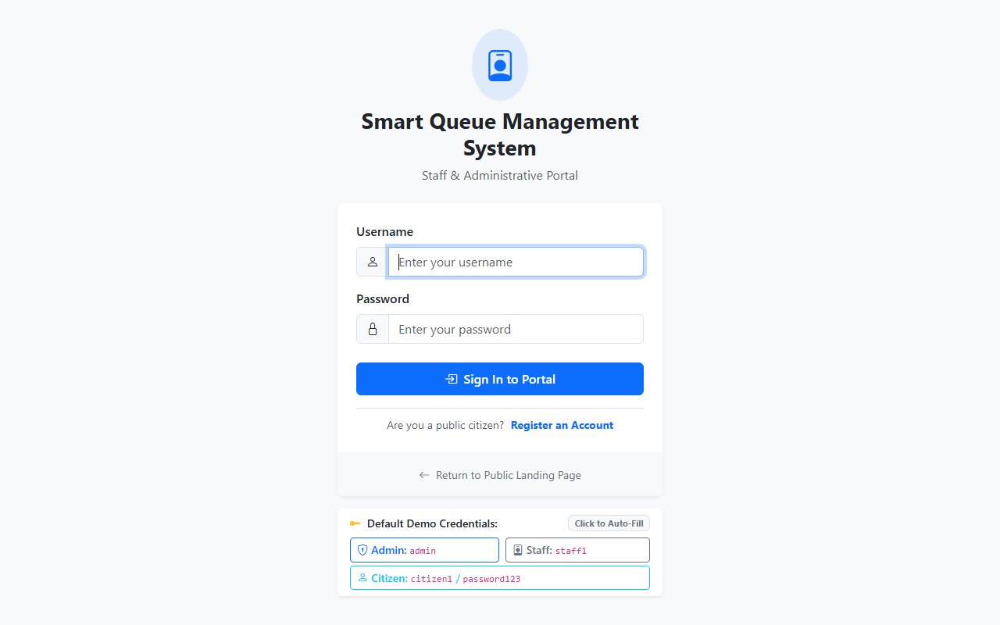
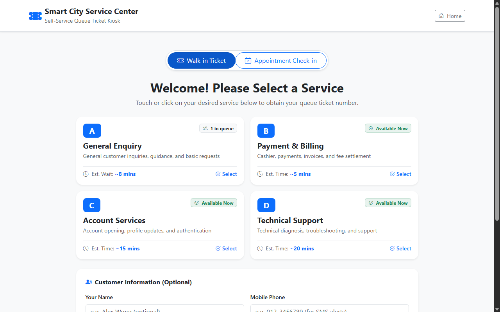
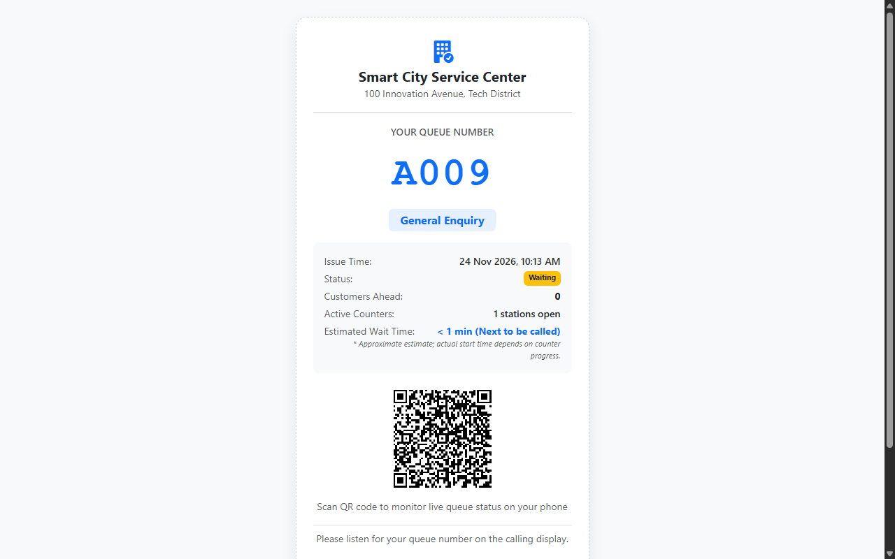
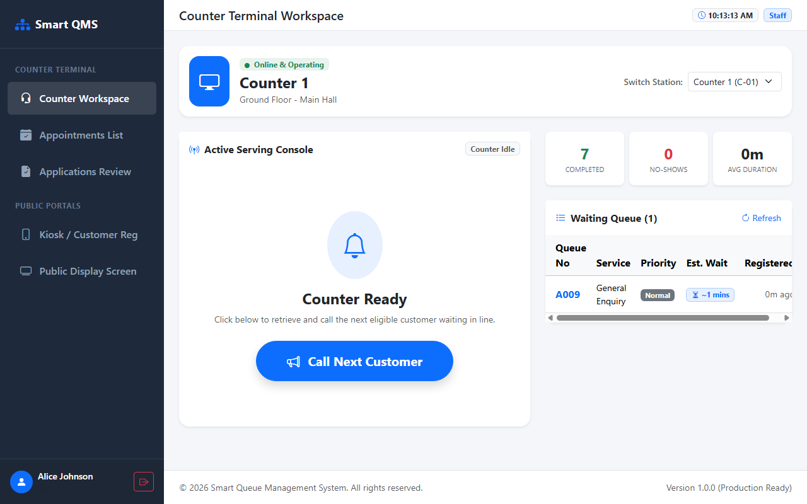
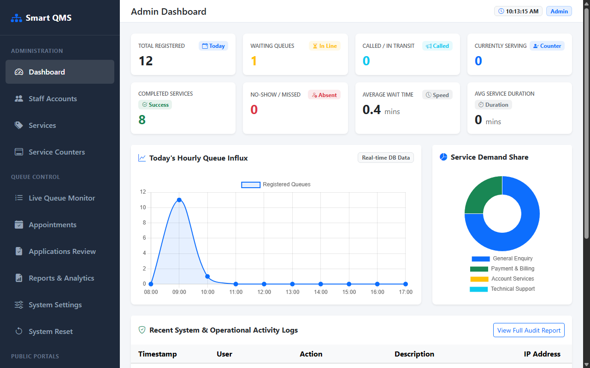
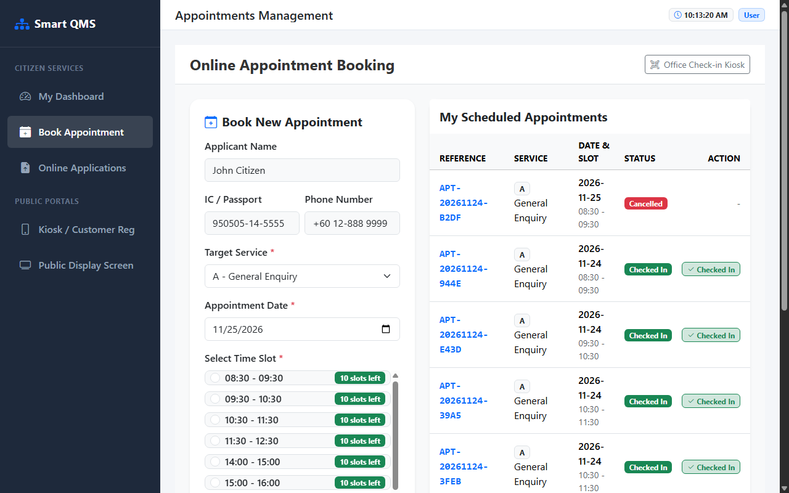
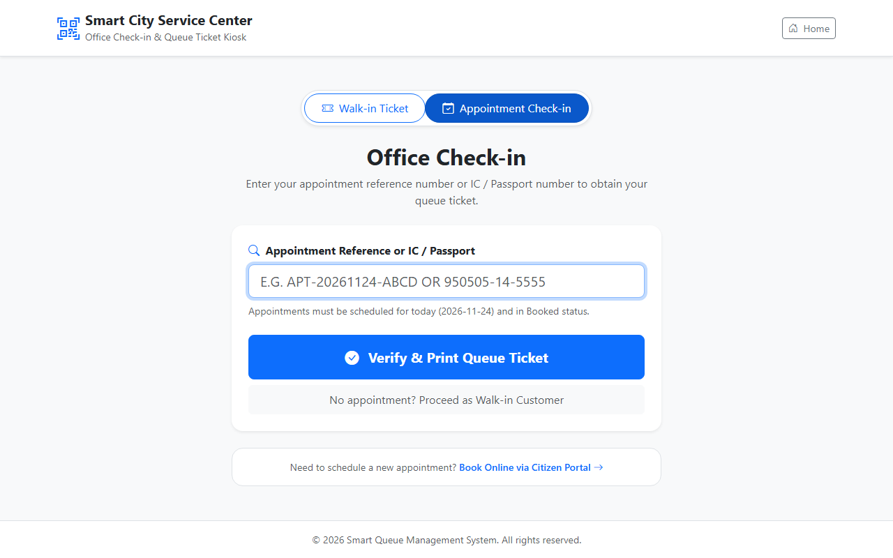
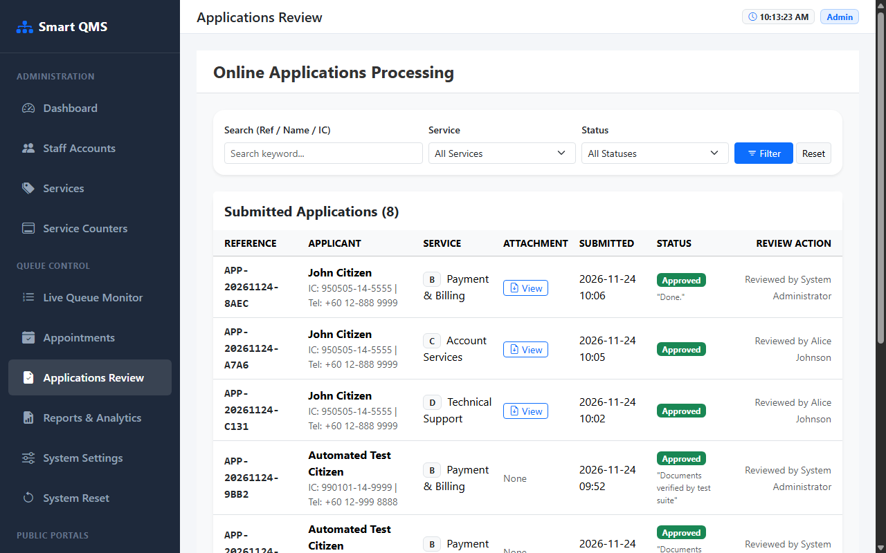
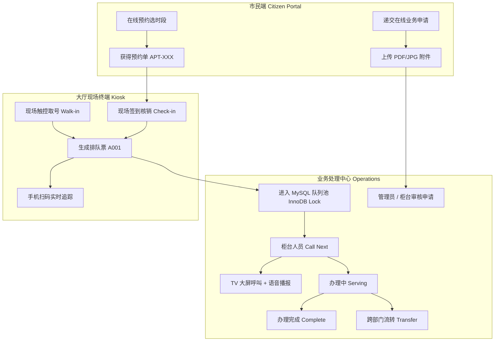

# Smart Queue Management System (QMS)

Enterprise-grade multi-counter queue calling, online appointment scheduling, and customer ticket management platform with real-time audio-visual announcements and citizen services.

## 快速开始（XAMPP）

1. 把项目放在 `C:\xampp\htdocs\queue_management_system`
2. 复制 `config/database.example.php` 为 `config/database.php`，确认 MySQL 数据库连接端口与账号
3. 启动 XAMPP 的 **Apache** 和 **MySQL** 服务
4. 运行一键数据库迁移与初始化脚本：
   ```bash
   php database/install.php
   ```
5. 打开浏览器访问主门户：[http://localhost/queue_management_system/](http://localhost/queue_management_system/)
6. **公众取号（Kiosk）**：打开 `http://localhost/queue_management_system/customer/` 触摸取号或扫描手机实时追踪二维码
7. **现场签到换号（Check-in）**：打开 `http://localhost/queue_management_system/customer/checkin.php` 输入预约号或身份证号直接兑换排队票
8. **电视大屏叫号（TV Display）**：打开 `http://localhost/queue_management_system/display/` 全屏展示叫号、蜂鸣提示音与语音播报
9. **工作人员柜台（Staff）**：使用 `staff1` / `password123` 登录 `http://localhost/queue_management_system/auth/login.php` 进行叫号、办理、完成或转号
10. **管理员后台（Admin）**：使用 `admin` / `password123` 登录，管理服务、柜台、人员、预约核销、申请审批与导出分析报表
11. **市民线上中心（Citizen）**：使用 `citizen1` / `password123` 登录或注册新账号，在线预约时段（查看剩余名额）及递交申请材料

**默认预设账号**：
- 系统管理员 (Admin)：`admin` / `password123`
- 柜台办事员 (Staff 1)：`staff1` / `password123` (Counter 1)
- 柜台办事员 (Staff 2)：`staff2` / `password123` (Counter 2)
- 公众市民用户 (Citizen)：`citizen1` / `password123`（亦可在注册页面即时创建）

---

## Features

- **Self-Service Kiosk (触控式自助取号机)**：支持服务部门分类选择、动态等待时间预估、打印小票及手机追踪二维码
- **Office Kiosk Check-in (现场预约签到换号)**：到场公众凭借线上预约单号或身份证/护照号一秒核销并换领排队小票
- **Citizen Online Portal (市民线上服务中心)**：市民专属控制台，展示历史预约统计、待审批申请进度与排队动态
- **Online Appointments Booking (时段预约系统)**：精准时段划分（如 08:30-09:30 等），实时计算剩余可用配额，支持预约凭单生成与自主取消
- **Online Applications Submission (在线业务申请递交)**：支持业务材料在线递交（PDF、JPG、PNG 附件安全上传），自动生成申请编号
- **Staff Counter Console (多柜台叫号工作台)**：包含叫号（Next）、重呼（Recall）、开始办理（Start Serving）、完成（Complete）、过号（No-Show）与跨部门转呼（Transfer）
- **Audio-Visual Public TV Display (全屏电视叫号看板)**：高对比度大厅呼叫屏幕，支持双音调蜂鸣提示音与 Web Speech API 原生语音报号合成
- **Real-Time Mobile Tracker (手机移动端排队追踪)**：基于 256 位加密 Token 的免登录移动端进度看板，实时查看排在前面的等待人数
- **Admin Command Center (管理控制中心)**：实时 KPI 监控、各服务饱和度分析、预约总览与 RFC 规范 CSV 导出
- **Applications Review Desk (在线申请后台审批)**：管理员与职员协同审核市民递交的文件材料，一键通过（Approve）或拒绝（Reject）并填写反馈批注
- **System Reset Tool (每日排队数据重置工具)**：管理员一键清空当日排队记录与叫号日志，自动归零各服务流水计数器
- **Atomic Concurrency Guarantee (高并发行级锁控制)**：MySQL InnoDB `FOR UPDATE` 行锁控制排号序列生成，杜绝跳号、断号与重复领号
- **Comprehensive Test Suite (自动化集成测试套件)**：内置 32 项自动化测试场景（`tests/run_tests.php`），覆盖核心业务全链路

---

## Screenshots

| 01. 系统登录入口 (Login Portal) | 02. 自助取号终端 (Customer Kiosk) |
| :---: | :---: |
|  |  |

| 03. 数字化排队票据 (Digital Ticket) | 04. 手机端实时排号跟踪 (Mobile Tracker) |
| :---: | :---: |
|  |  |

| 05. 大厅呼叫大屏 (TV Calling Display) | 06. 柜台人员操作台 (Staff Counter Console) |
| :---: | :---: |
|  |  |

| 07. 管理员运营总览 (Admin Dashboard) | 08. 实时队列监管 (Live Queue Monitor) |
| :---: | :---: |
|  |  |

| 09. 业务分析与报表导出 (Reports & CSV) | 10. 市民时段预约 (Online Appointments) |
| :---: | :---: |
|  |  |

| 11. 办事处预约签到换号 (Office Check-in) | 12. 在线业务材料审批 (Applications Review) |
| :---: | :---: |
|  |  |

---

## Folder Structure

```
queue_management_system/
├── admin/                     # 管理后台控制模块
│   ├── applications/          # 在线业务申请审核处理
│   ├── appointments/          # 全厅预约记录检索与核销
│   ├── counters/              # 物理服务柜台配置
│   ├── queues/                # 实时排队大厅监管中心
│   ├── reports/               # 运营指标与 CSV 报表导出
│   ├── services/              # 业务服务类型与容量设定
│   ├── settings/              # 机构名称、叫号间隔等全局参数
│   ├── users/                 # 职员账号与权限配置
│   ├── dashboard.php          # 管理员 KPI 数据总览
│   └── system_reset.php       # 每日排队与计数序列重置工具
├── api/                       # 前端 AJAX 轮询与实时数据接口
│   ├── display_data.php       # TV 大屏呼叫队列与语音播报接口
│   └── queue_status.php       # 手机追踪端排队进度查询接口
├── assets/                    # 静态资源 (CSS、Bootstrap、图标)
├── auth/                      # 权限认证与登录注销
│   ├── login.php              # 多角色统一登录入口
│   ├── logout.php             # 安全注销退出
│   └── register.php           # 公众市民账号注册页面
├── config/                    # 系统核心配置与数据库连接
│   ├── config.php             # 全局常量、会话与工具函数
│   └── database.php           # PDO 数据库连接参数 (Git 忽略)
├── customer/                  # 公众端交互终端
│   ├── checkin.php            # 预约现场核销签到换号
│   ├── index.php              # Kiosk 自助触控取号终端
│   ├── register.php           # 原子发号事务处理逻辑
│   ├── ticket.php             # 电子排队票据与二维码生成
│   └── track.php              # 手机免登录实时排队跟踪
├── database/                  # 数据库架构与安装引擎
│   ├── install.php            # 命令行自动化安装与端口自适应检测
│   └── queue_management_system.sql # 完整 20 表 InnoDB 架构与种子数据
├── display/                   # 电视全屏音画呼叫看板
├── docs/screenshots/          # 项目真实界面高清截图
├── includes/                  # 公共组件 (Header, Sidebar, Footer, CSRF, Functions)
├── scripts/                   # 真实截图自动化抓取与辅助工具
├── staff/                     # 柜台办事员终端
│   ├── applications.php       # 柜台协同材料审批
│   ├── appointments.php       # 柜台预约名单查看与签到
│   ├── call_next.php          # 呼叫下一位等待顾客
│   ├── complete.php           # 业务办理完成结算
│   ├── dashboard.php          # 柜台操作主工作区
│   ├── no_show.php            # 顾客未到场过号标记
│   ├── recall.php             # 重复语音播报呼叫
│   ├── start_serving.php      # 开始正式受理业务
│   └── transfer.php           # 跨部门/跨柜台流转
├── tests/                     # 32 项自动化集成测试套件 (run_tests.php)
├── uploads/                   # 公民递交材料安全隔离目录
├── user/                      # 公众市民个人服务门户
│   ├── applications.php       # 在线申请表提交与材料上传
│   ├── appointments.php       # 在线预约办理与配额选择
│   └── dashboard.php          # 市民个人服务中心看板
└── index.php                  # 系统门户导航大厅 (Main Portal Hub)
```

---

## 1. XAMPP 安装与数据库配置

1. 将本项目解压或放置于 `C:\xampp\htdocs\queue_management_system`
2. 打开 XAMPP 控制面板，启动 **Apache** 和 **MySQL**
3. 复制数据库配置文件模板：
   ```bash
   copy config\database.example.php config\database.php
   ```
4. 运行一键式安装脚本：
   ```bash
   php database/install.php
   ```
   *安装脚本将智能自适应探测 MySQL 端口（3306 或 3307），自动创建 `queue_management_system` 数据库并初始化 20 张关联数据表及默认演示数据。*
5. 验证安装：浏览器打开 [http://localhost/queue_management_system/](http://localhost/queue_management_system/) 即可查看系统主门户。

---

## 2. 自助取号与现场签到 (Kiosk & Office Check-in)

- 访问地址：`http://localhost/queue_management_system/customer/`
- **现场取号 (Walk-in)**：选择服务业务分类（如 General Enquiry、Payment & Billing 等），输入姓名及电话，点击确认取号。系统使用数据库行锁立即生成当前流水号（如 `A001`）并生成带加密 Token 的专属二维码。
- **预约签到换号 (Office Check-in)**：访问 `customer/checkin.php`（或在取号机顶部切换标签），输入线上预约参考号（如 `APT-20261124-XXXX`）或身份证/护照号。系统核验当日有效预约后，自动将其签到并转换为排队小票。
- **手机扫码追踪**：办事人员手机扫描小票二维码（`customer/track.php?token=...`），即可在手机上实时掌握前方等待人数与排号变动，无需在现场盲目驻留。

---

## 3. 市民线上预约中心 (Online Appointments)

- 市民通过 `auth/register.php` 注册个人账号后登录市民中心。
- 打开 `user/appointments.php`：
  - 选择目标业务部门；
  - 选择前往办事的日期；
  - 实时查看各个时间段（`08:30-09:30`、`09:30-10:30` 等）的剩余名额配额；
  - 确认预约并生成全局唯一的预约凭单号（`APT-YYYYMMDD-XXXX`）；
  - 支持查看个人历史预约，并在需要时自主取消。

---

## 4. 在线业务申请与后台审批 (Online Applications Workflow)

- **市民递交**：市民登录后进入 `user/applications.php`，选择办理业务，填写申请人背景资料并上传支持材料（PDF、JPG、PNG，限制 5MB 内）。系统生成追踪单号（`APP-YYYYMMDD-XXXX`）。
- **后台与前台协同审批**：
  - 管理员（`admin/applications/index.php`）与柜台人员（`staff/applications.php`）可在审批中心查阅市民递交的材料；
  - 点击“View File”即可安全在线查验上传附件；
  - 审核人员点击 **Approve**（通过）或 **Reject**（拒绝），并可附带具体的审核反馈意见。

---

## 5. 电视呼叫大屏与智能语音播报 (Public Display)

- 大厅电视或展示平板打开：`http://localhost/queue_management_system/display/`
- 点击页面任意区域解锁浏览器自动播放权限；
- 当柜台职员呼叫或重呼时，系统自动触发蜂鸣提示音，并通过 Web Speech API 播报自然人声（例如：“*Queue number A001, please proceed to Counter 1*”）；
- 屏幕右侧显示当前各柜台正在服务的号码，左侧滚动显示等候队列列表。

---

## 6. 柜台人员操作台 (Staff Counter Console)

- 办事员登录（`staff1` / `password123`）后进入：`staff/dashboard.php`
- **Next**：调用下一个处于等待状态的号码（严格遵循优先权与时间戳顺序）；
- **Recall**：重新呼叫当前号码，触发呼叫大屏声画联动；
- **Start Serving**：记录正式受理时间点，开始计算服务时长；
- **Complete**：结束本次业务，记录完成时间并释放柜台；
- **No-Show**：客户未到场，标记为过号；
- **Transfer**：业务需跨部门办理时，无缝将当前工单转派至其他业务队列，保留完整流转审计追踪。

---

## 7. 运营报表与数据分析 (Admin Reports)

- 管理员进入 `admin/reports/index.php`：
  - 查看当日及历史周期的完成率、平均等待时间（Avg Wait Time）和平均服务用时（Avg Service Duration）；
  - 查看各柜台与业务部门的吞吐效率；
  - 支持按日期范围导出符合 RFC 标准的 CSV 报表（`admin/reports/export.php`）。

---

## 8. 系统重置与每日初始化 (System Reset)

- 管理员工具路径：`admin/system_reset.php`
- 在每日大厅开始营业前或演练测试后，管理员可执行**一键排队重置**：
  - 清理当天的排队单、呼叫记录与流转日志；
  - 将各业务类别的排号序列（`queue_sequences`）归零重新从 `001` 开始发号；
  - 自动归档并关闭所有未退出的柜台工作会话。

---

## 9. 核心业务流程图 (System Architecture Flow)



---

## 10. 安全与隐私保护 (Security & Privacy)

- **密码安全**：所有账号密码均使用 PHP 原生 `password_hash(..., PASSWORD_BCRYPT)` 单向加密存储。
- **CSRF 跨站防护**：所有 POST 操作必须携带安全令牌（`csrf_field()` / `require_csrf()`）。
- **行级事务并发锁**：取号发号逻辑采用 `SELECT ... FOR UPDATE` 事务隔离，确保在高并发下不重复发号。
- **隐私文件物理隔离**：
  - `config/database.php` 独立于版本库；
  - 公民递交的身份证件及申请材料存放在 `uploads/applications/`，已在 `.gitignore` 中彻底过滤，保护个人隐私绝不外泄；
  - 临时测试脚本、日志文件（`*.log`）均在版本控制中自动忽略。

---

## 11. 自动化测试套件 (Test Suite)

项目内置了全套集成自动化测试脚本，执行以下命令即可一键完成全链路场景检验：

```bash
php tests/run_tests.php
```

**测试覆盖清单（32 项集成场景）**：
1. **Group 1**: 数据库 20 张表结构、管理员密码及种子数据完整性校验；
2. **Group 2**: 基础服务发号、序列自增唯一性、容量上限拒绝逻辑验证；
3. **Group 3**: 队列行锁状态机流转（Waiting → Called → Serving → Completed）；
4. **Group 4**: 非法状态机越权拦截（禁止直接完成未叫号工单、禁止过号已完成工单）；
5. **Group 5**: 队列跨部门流转（Transfer）与审计关联链条测试；
6. **Group 6**: 256 位加密 Token 校验与非法防伪测试；
7. **Group 7**: 多服务模型动态等候时间算法与报表聚合检验；
8. **Group 8**: 在线预约可用时段配额计算、预约创建与现场签到换领小票链路；
9. **Group 9**: 在线申请提交、附件记录、审核意见与状态流转闭环。

---

## License

This project is licensed under the [MIT License](LICENSE).
