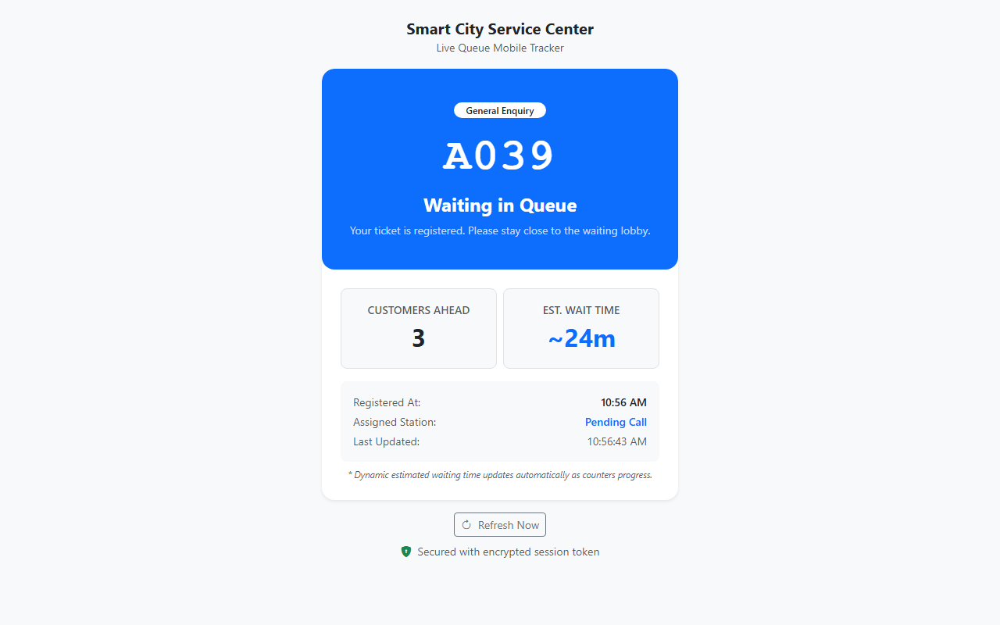
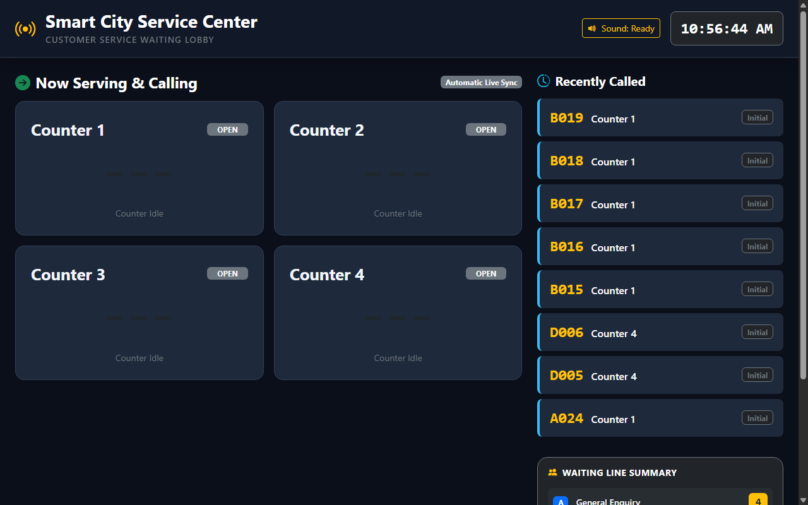
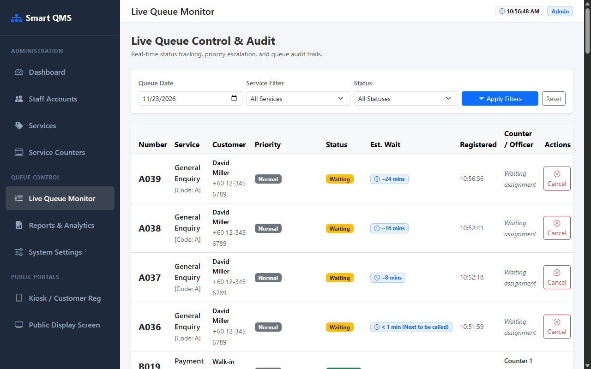
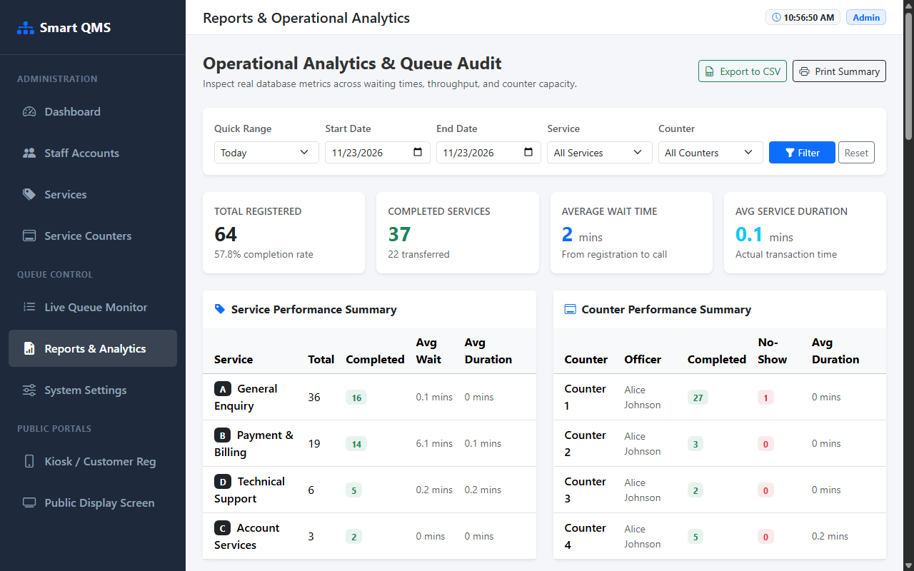

# Smart Queue Management System (QMS)
Enterprise-grade queue calling and ticket management platform for service halls, clinics, and customer centers.

## Quick Start (XAMPP)
1. Place this project inside `C:\xampp\htdocs\queue_management_system`
2. Duplicate `config/database.example.php` to `config/database.php` and verify MySQL credentials
3. Start **Apache** and **MySQL** services in the XAMPP Control Panel
4. Initialize database schema and seeds by running:
   ```bash
   php database/install.php
   ```
5. Navigate to `http://localhost/queue_management_system/` in your browser
6. Customer Registration: Open `http://localhost/queue_management_system/customer/` to print a ticket or scan mobile QR code
7. Public TV Calling Screen: Open `http://localhost/queue_management_system/display/` to view called numbers with chime audio and voice speech announcements
8. Staff Console: Log in at `http://localhost/queue_management_system/auth/login.php` using `staff1` / `password123` to call next tickets and manage service counters
9. Admin Portal: Log in using `admin` / `password123` to manage counters, monitor active queues, and export analytical reports

Default credentials:
- Administrator: `admin` / `password123`
- Staff Officer: `staff1` / `password123` (Counter 1) or `staff2` / `password123` (Counter 2)

## Features
- **Self-Service Kiosk**: Touch-friendly customer ticket registration with dynamic wait time estimation and QR code generation
- **Mobile Queue Tracker**: Real-time position tracking via secure 256-bit cryptographic tokens without requiring login
- **Audio-Visual Public TV Display**: Fullscreen calling board with multi-tone audio chimes and native Web Speech API voice announcements
- **Atomic Concurrency Control**: MySQL InnoDB row-level locking (`FOR UPDATE`) preventing race conditions and double-calling
- **Staff Counter Console**: Multi-counter support with Next, Recall, Start Serving, Complete, No-Show, and Transfer actions
- **Service Cross-Transfer**: Seamless ticket reassignment across departments with linked audit history
- **Admin Command Center**: Real-time KPI summaries, queue wait analytics, service capacity limits, and RFC-compliant CSV report exports
- **Automated Verification**: Built-in 25-scenario comprehensive integration test suite (`tests/run_tests.php`)

## Screenshots

| Customer Kiosk Registration | Digital Ticket & QR Code |
|:---:|:---:|
|  |  |

| Mobile Live Ticket Tracker | Public TV Calling Display |
|:---:|:---:|
|  |  |

| Staff Counter Console | Staff & Admin Authentication |
|:---:|:---:|
|  |  |

| Admin KPI Dashboard | Live Queue Supervisor |
|:---:|:---:|
|  |  |

| Analytics & CSV Reports |
|:---:|
|  |

## Folder Structure
```
queue_management_system/
├── admin/                 Admin management views (counters, services, reports, users)
├── api/                   AJAX endpoints for display board & mobile polling
├── assets/                CSS stylesheets, vendor icons, and layout assets
├── auth/                  Authentication handlers (login, logout, session guards)
├── config/                System settings and database connection classes
├── customer/              Self-service kiosk, ticket rendering, and mobile tracker
├── database/              Schema definition scripts and automated installer
├── display/               Full-screen audio-visual public calling monitor
├── docs/screenshots/      Application interface preview images
├── includes/              Shared templates, role verifiers, CSRF, and helper functions
├── scripts/               Utility tasks and automated screenshot generator
├── staff/                 Staff counter console, ticket progression, and transfer actions
└── tests/                 25-scenario automated verification test runner
```

## 1. XAMPP Setup & Database Initialization
1. Ensure your project directory is located at `C:\xampp\htdocs\queue_management_system`
2. Start both **Apache** and **MySQL** via XAMPP Control Panel
3. Copy the configuration template:
   ```bash
   cp config/database.example.php config/database.php
   ```
4. Run the automated database installer:
   ```bash
   php database/install.php
   ```
   The installer automatically checks default MySQL ports (3306 and 3307), creates the `queue_management_system` database, builds all 18 tables, and seeds initial services and demo users.
5. If you prefer using phpMyAdmin, create a database named `queue_management_system` and import `database/queue_management_system.sql`.

## 2. Customer Kiosk & Live Tracking
- Open `http://localhost/queue_management_system/customer/`
- Select the desired service department (e.g., General Inquiries, Payments & Billing, Customer Support)
- Enter the customer name and optional contact number
- Click **Take Ticket** to generate an atomic sequence number (e.g., `A001`)
- The ticket page provides an on-screen printable slip with an embedded QR code
- Customers can scan the QR code on mobile devices to track their live queue position without refreshing

## 3. Public Calling Display & Voice Synthesis
- Launch `http://localhost/queue_management_system/display/` on hall TV monitors or secondary displays
- Uses non-blocking polling (`api/display_data.php`) to fetch called numbers in real time
- Plays a two-tone alert chime through Web Audio API
- Uses browser SpeechSynthesis to announce tickets audibly (e.g., *"Queue Number A001, please proceed to Counter 1"*)

## 4. Staff Counter Console
- Staff members sign in at `http://localhost/queue_management_system/auth/login.php`
- Access the operational console at `http://localhost/queue_management_system/staff/dashboard.php`
- Select your active counter (Counter 1 or Counter 2)
- Operational controls:
  - **Call Next**: Retrieves the earliest waiting ticket using MySQL `FOR UPDATE` transaction locks
  - **Recall**: Re-triggers voice announcements on the public display
  - **Start Serving**: Marks service commencement and calculates exact customer wait duration
  - **Complete**: Concludes the transaction, records completion timestamp, and frees the counter
  - **Transfer**: Reroutes customer to another department while preserving ticket lineage
  - **No-Show**: Records unattended calls with reason logging

## 5. Admin Dashboard & Analytical Reports
- Log in with administrator account (`admin` / `password123`)
- **Dashboard**: High-level overview of daily tickets, average wait times, active counters, and hourly traffic distribution
- **Counters & Services**: Configure department prefix codes, daily volume limits, and counter assignments
- **Queue Monitor**: Real-time administrative oversight with manual priority adjustments and ticket cancellations
- **Reports & Export**: Filter queue metrics by date range, counter, or service with instant RFC-compliant CSV export

## 6. Automated Testing
Run the verification test suite directly from your terminal:
```bash
php tests/run_tests.php
```
The test suite validates 25 scenarios including database schema integrity, sequence increments, atomic concurrency locks, invalid state transition rejections, cryptographic token security, and analytical calculations.

## System Lifecycle Flow
```
[ Customer Kiosk ] ──> Ticket Issued: "Waiting"
                             │
                             ▼
[ Staff Console ]  ──> Click "Call Next": "Called" (Broadcasted to Public TV Screen)
                             │
                ┌────────────┴────────────┐
                ▼                         ▼
         "Start Serving"               "No-Show"
                │
                ├────────────┐
                ▼            ▼
          "Completed"   "Transferred" ──> Linked New Ticket in "Waiting"
```

## Security & Data Integrity
- **Database Transactions**: All state modifications utilize InnoDB ACID transactions with row-level locks
- **Token Cryptography**: Customer tracking URLs use 256-bit cryptographically secure random tokens with SHA-256 storage
- **CSRF Defense**: All POST requests are protected by synchronized session CSRF tokens
- **SQL Injection Prevention**: Database interactions strictly use PDO prepared statements with parameter binding
- **Credential Protection**: Passwords stored using standard `password_hash()` and verified with `password_verify()`
- **Privacy Shield**: Production credentials, logs, and sensitive configurations are guarded via `.gitignore`

## License
This project is licensed under the [MIT License](LICENSE).
# Queue-Management-System

